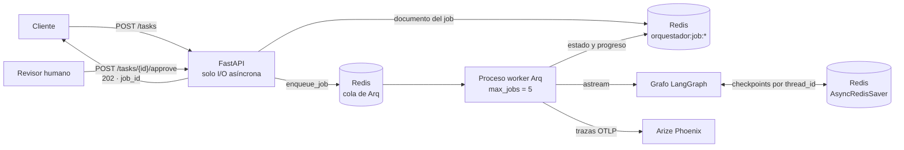
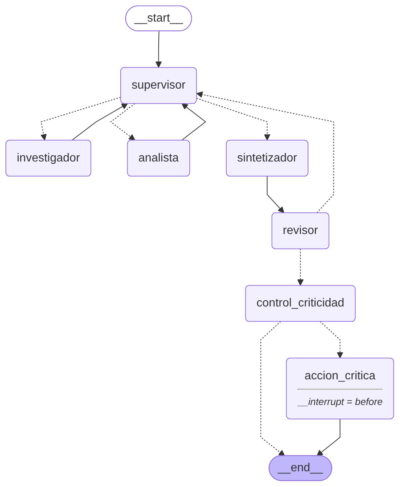
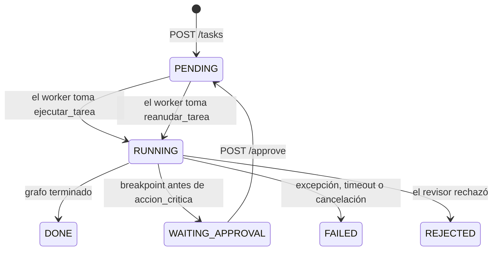

# Orquestador multi-agente en producción: FastAPI + Arq + Redis + Phoenix

API REST asíncrona que expone el orquestador planificador del Módulo 6 (Supervisor que planifica tareas, Agente de Investigación, Agente de Análisis, Sintetizador y Revisor). La API solo encola: las ejecuciones corren en **workers Arq** en un proceso aparte, el estado de los trabajos y los checkpoints de LangGraph viven en **Redis**, cada ejecución se traza en **Arize Phoenix** y las tareas críticas quedan detenidas en un **breakpoint del grafo** hasta que una persona las aprueba.

## Arquitectura



| Proceso | Responsabilidad |
|---|---|
| `api` (uvicorn) | Recibe, valida y encola. No importa el grafo ni llama al modelo, así que no hay nada que pueda bloquear el event loop |
| `worker` (`arq app.worker.WorkerSettings`) | Ejecuta hasta `MAX_JOBS` grafos en paralelo, actualiza el estado del job, mide tokens y envía las trazas |
| `redis` (Redis 8) | Documentos de jobs, cola de Arq, latido del worker y checkpoints de LangGraph |
| `phoenix` | Recibe trazas OTLP, calcula costo por traza y percentiles de latencia |

Separar la API del worker permite escalar cada parte por su lado (más réplicas de `worker` con `docker compose up --scale worker=3`) y hace que una ejecución pesada nunca afecte los tiempos de respuesta de la API.

## Grafo



Es el grafo del Módulo 6 sin cambios en sus nodos, con dos nodos nuevos al final:

- `control_criticidad`: después de que el revisor aprueba el informe, decide si la tarea es crítica.
- `accion_critica`: ejecuta la acción con efectos secundarios. El grafo se compila con `interrupt_before=["accion_critica"]`, así que **nunca** llega a este nodo sin pasar antes por una pausa.

```python
grafo.compile(checkpointer=checkpointer, interrupt_before=["accion_critica"])
```

## Estructura

| Ruta | Contenido | Criterio |
|---|---|---|
| `app/main.py` | FastAPI con `APIRouter` y dependencias: `POST /tasks`, `GET /tasks/{id}`, `POST /tasks/{id}/approve`, `GET /tasks`, `GET /health` | Orquestación asíncrona y API |
| `app/worker.py` | Funciones de Arq `ejecutar_tarea` y `reanudar_tarea`, `WorkerSettings`, manejo de `FAILED`, timeout y cancelación | Orquestación asíncrona y API |
| `app/jobs.py` | Repositorio de jobs en Redis con transacciones optimistas `WATCH/MULTI` | Persistencia con Redis |
| `app/graph.py` | Grafo del Módulo 6 + nodos de producción + `AsyncRedisSaver` | Persistencia con Redis |
| `app/observability.py` | Phoenix, `LangChainInstrumentor`, decorador `@trazar_chain` y traza raíz por tarea | Observabilidad |
| `app/metrics.py` | Callback de LangChain que mide tokens, llamadas y tiempo por nodo | Observabilidad |
| `app/hitl.py` | Estado de producción, criterios de criticidad, nodo crítico y aplicación de la decisión humana | Human-in-the-loop |
| `app/settings.py` | Configuración tipada con `pydantic-settings` | Estructura |
| `app/schemas.py` | Modelos de entrada y salida de la API | Estructura |
| `app/orquestador/` | Orquestador planificador del Módulo 6: agentes, herramientas, estado, validación y base documental | — |
| `scripts/prueba_carga.py` | Prueba de 5 peticiones concurrentes | Observabilidad |
| `screenshots/` | Capturas de Phoenix | Observabilidad |
| `docker-compose.yml`, `Dockerfile` | Redis 8, Phoenix, API y worker | Despliegue |

## API

| Endpoint | Respuesta | Descripción |
|---|---|---|
| `POST /tasks` | `202` | Crea el job, lo encola en Arq y devuelve `job_id`. Cuerpo: `{"consulta": "...", "publicar_para": ["..."]}` |
| `GET /tasks/{job_id}` | `200` / `404` | Estado, progreso en vivo (`ultimo_nodo`, `pasos`), historial de estados, solicitud de aprobación, resultado, consumo y error |
| `POST /tasks/{job_id}/approve` | `202` / `404` / `409` | Decisión humana `{"aprobado": bool, "revisor": "...", "comentario": "..."}`. `409` si la tarea no espera aprobación |
| `GET /tasks?estado=WAITING_APPROVAL` | `200` | Tareas recientes, con filtro por estado |
| `GET /health` | `200` | Redis, tareas en cola y último latido del worker de Arq |

Documentación interactiva en http://localhost:8000/docs.

### Ciclo de vida de un job



Cada cambio queda en `historial` con su momento, y `progreso` se actualiza después de cada nodo del grafo, así el cliente puede ver por dónde va la ejecución mientras hace polling.

## Persistencia en Redis

| Clave | Contenido |
|---|---|
| `orquestador:job:{job_id}` | Documento JSON del job, con TTL de 7 días |
| `orquestador:jobs` | Sorted set con los jobs por fecha, para `GET /tasks` |
| `orquestador:publicaciones` | Informes publicados por la herramienta `publicar_informe` |
| `arq:queue`, `arq:job:*`, `arq:queue:health-check` | Cola, resultados y latido de Arq |
| `checkpoint:*` | Checkpoints de LangGraph (`AsyncRedisSaver`), con TTL configurable |

- **Checkpoints**: `AsyncRedisSaver` guarda el estado del grafo después de cada nodo con `thread_id = job_id`. Por eso una tarea pausada puede retomarse en otro proceso worker o después de un reinicio. Requiere Redis 8, que trae los módulos JSON y Search; la imagen `redis:8` de Docker Compose ya los incluye.
- **Concurrencia**: cada cambio de estado se hace con `WATCH` + `MULTI`. Si otro proceso modificó el job en el medio, la transacción se reintenta; si el estado de origen no es el esperado, la transición se rechaza. Así una tarea no puede aprobarse dos veces ni tomarse por dos workers.
- **Idempotencia de la cola**: los trabajos se encolan con `_job_id` fijo (`{job_id}:ejecucion`, `{job_id}:reanudacion`), por lo que Arq no duplica una ejecución aunque se reintente el encolado.

### Errores en segundo plano

El worker cubre tres caminos para que un job nunca quede en `RUNNING`:

| Situación | Cómo se detecta | Resultado |
|---|---|---|
| Excepción del grafo, el modelo o una herramienta | `except Exception` | `FAILED` con tipo y mensaje del error |
| La ejecución supera `JOB_TIMEOUT_SEGUNDOS` | `asyncio.wait_for` | `FAILED` por timeout |
| Arq cancela la tarea (su `job_timeout` o un apagado del worker) | `except asyncio.CancelledError`, que no hereda de `Exception` | `FAILED` por cancelación, escrito con `asyncio.shield` antes de propagar la cancelación |

`max_tries = 1` evita que Arq reintente por su cuenta una tarea que pudo haber ejecutado una acción con efectos secundarios.

## Observabilidad con Arize Phoenix

- **Instrumentación**: `LangChainInstrumentor` de OpenInference traza cada nodo del grafo, cada agente ReAct, cada llamada al modelo y cada herramienta.
- **Una traza por ejecución**: el worker abre un span raíz `tarea.ejecucion` o `tarea.reanudacion` con `using_attributes(session_id=job_id, ...)`. Las dos trazas de una tarea con aprobación humana quedan agrupadas en la misma sesión.
- **Decoradores**: `@trazar_chain` usa el decorador nativo `tracer.chain` de OpenInference; por ejemplo, `hitl.evaluar_criticidad` aparece como span propio con sus entradas y su salida.
- **Solo ejecuciones**: el proveedor de trazas se registra sin reemplazar al global, y la API no se instrumenta. Así el p95 de Phoenix corresponde a las ejecuciones de los agentes y no a las consultas de estado.
- **Costo**: los spans de LLM llevan el modelo y los tokens de entrada y salida; Phoenix calcula el costo de cada traza a partir de ellos.

### Tokens y tiempo por nodo

`app/metrics.py` define `MedidorDeConsumo`, un callback de LangChain que se pasa en la configuración de cada ejecución. Usa el `langgraph_checkpoint_ns` de cada llamada al modelo para atribuirla al nodo del grafo de primer nivel, incluso cuando ocurre dentro del ciclo ReAct interno de un especialista. El resultado queda en `consumos` de cada job y alimenta el resumen de la prueba de carga. No fue necesario modificar el código del Módulo 6.

## Human-in-the-loop

Una tarea es **crítica** si cumple al menos una condición:

| Criterio | Condición |
|---|---|
| Efecto secundario | Pide publicar el informe (`publicar_para` no vacío). La publicación no se puede deshacer |
| Costo alto | La ejecución consumió más tokens que `UMBRAL_TOKENS_APROBACION` (80000 por defecto) |

Cuando el revisor aprueba el informe, `control_criticidad` evalúa los criterios. Si la tarea es crítica, el grafo se detiene **antes** de `accion_critica` por el breakpoint, el estado queda en Redis y el job pasa a `WAITING_APPROVAL` con una `solicitud_aprobacion` que incluye los motivos, la acción y el informe propuesto.

La señal externa llega por la API:

```bash
curl -X POST http://localhost:8000/tasks/<job_id>/approve \
  -H "Content-Type: application/json" \
  -d '{"aprobado": true, "revisor": "lucia", "comentario": "Publicar"}'
```

El worker retoma la tarea en `reanudar_tarea`:

- **Aprobada**: registra la decisión con `aupdate_state` y continúa con `ainvoke(None)`. Se ejecuta `accion_critica`, que llama a la herramienta `publicar_informe`. El job termina en `DONE`.
- **Rechazada**: registra la decisión con `aupdate_state(..., as_node="accion_critica")`, que da el nodo por resuelto sin ejecutarlo. No se publica nada y el job termina en `REJECTED`.

Además, `accion_critica` verifica que exista una aprobación registrada antes de actuar.

## Cómo levantarlo

```bash
cp .env.example .env
```

En Windows: `copy .env.example .env`. Completar la API key del proveedor.

| Variable | Descripción |
|---|---|
| `LLM_PROVIDER` / `OPENAI_API_KEY` / `ANTHROPIC_API_KEY` / `LLM_MODEL` | Modelo y credenciales |
| `REDIS_URL` | Redis 8. Por defecto `redis://localhost:6379/0` |
| `CHECKPOINTER` | `redis` (por defecto) o `memory` solo para desarrollo |
| `OBSERVABILIDAD` | `phoenix` (por defecto) o `ninguna` |
| `PHOENIX_COLLECTOR_ENDPOINT` / `PHOENIX_PROJECT_NAME` | Destino de las trazas |
| `MAX_JOBS` | Ejecuciones simultáneas por worker. Por defecto 5, una por petición de la prueba |
| `JOB_TIMEOUT_SEGUNDOS` | Tiempo máximo por ejecución |
| `UMBRAL_TOKENS_APROBACION` | Tokens a partir de los cuales una ejecución requiere aprobación |

### Opción A: todo con Docker Compose

```bash
docker compose up --build
```

Servicios: Redis en `6379`, Phoenix en http://localhost:6006, API en http://localhost:8000 y el worker.

### Opción B: Redis y Phoenix en Docker, API y worker locales

```bash
docker compose up -d redis phoenix
python3.12 -m venv .venv
source .venv/bin/activate
pip install -r requirements.txt
uvicorn app.main:app --port 8000
```

En otra terminal, con el entorno activo:

```bash
arq app.worker.WorkerSettings
```

En Windows: `py -3.12 -m venv .venv` y `.venv\Scripts\activate`. Verificación: `curl http://localhost:8000/health` debe mostrar el latido del worker.

## Prueba de 5 peticiones concurrentes

Con todo levantado:

```bash
python scripts/prueba_carga.py
```

El script:

1. Envía 5 consultas distintas a `POST /tasks` en paralelo con `asyncio.gather` y mide el tiempo de encolado.
2. Hace polling de cada job hasta su estado final.
3. Calcula p50 y p95 del encolado y de la ejecución en el worker, los tokens por ejecución y los tokens, llamadas y segundos de cada nodo.
4. Guarda el detalle en `resultados/carga_<fecha>.json` y completa la sección siguiente de este README.

Variante con aprobación humana, donde cada consulta pide publicar el informe y el script aprueba cada pausa:

```bash
python scripts/prueba_carga.py --hitl
```

Después, en Phoenix (http://localhost:6006, proyecto `orquestador-planificador`, rango **Last 15 Minutes**), tomar las capturas listadas en [`screenshots/README.md`](screenshots/README.md):

- **Costo por ejecución**: pestaña **Traces**, columna `total cost` de cada `tarea.ejecucion`.
- **Latencia p95**: pestaña **Metrics**, gráfico **Trace latency**, línea **P95**.

## Resultados de la prueba de carga

<!-- RESULTADOS_CARGA -->
Se completa al ejecutar `python scripts/prueba_carga.py`.
<!-- /RESULTADOS_CARGA -->

## Lectura del dashboard

- **Concurrencia real**: las 5 trazas arrancan juntas y duran parecido. Si el worker las ejecutara de a una, cada traza terminaría donde empieza la siguiente. El encolado se mantiene en milisegundos porque la API no ejecuta nada.
- **Dónde se concentra la latencia**: en los especialistas, que son agentes ReAct con varias llamadas al modelo (decidir herramientas, procesar resultados y generar la salida estructurada), y en el supervisor, que se invoca una vez por cada tarea del plan más la decisión de sintetizar. Herramientas, validación y `control_criticidad` aparecen con duraciones de milisegundos en el árbol de spans.
- **Qué nodo consume más tokens**: lo indica la tabla de resultados. El analista recibe como insumo las salidas estructuradas completas del investigador, y el supervisor reenvía el plan y el último aporte en cada decisión, por lo que ambos concentran los tokens de entrada.
- **Costo**: la columna `total cost` da el costo de cada ejecución y el gráfico **Cost** lo separa en entrada y salida. Por el contexto que se reenvía en cada llamada, los tokens de entrada son la mayor parte del costo.

## Capturas

En [`screenshots/`](screenshots/).
